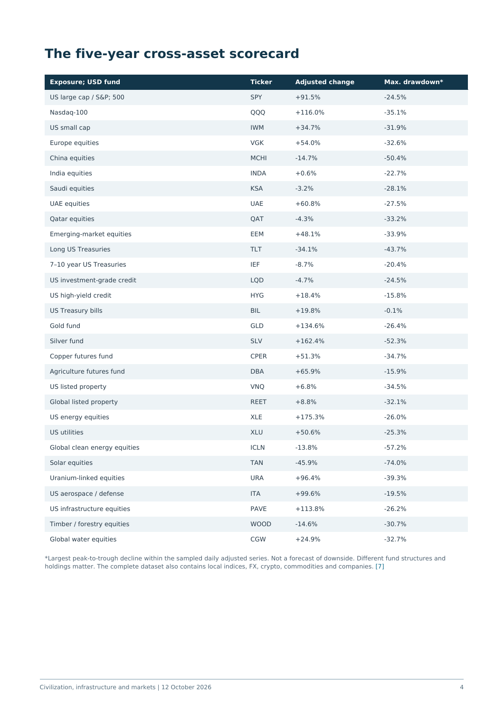
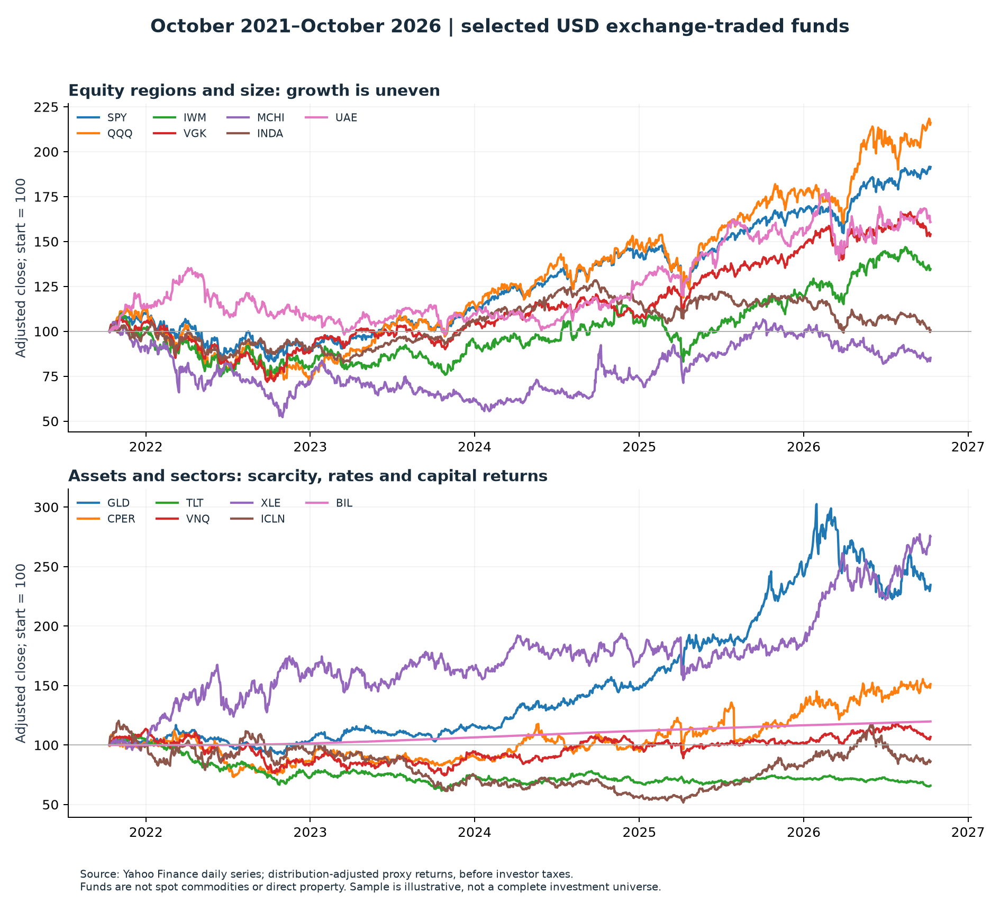

# Civilization Infrastructure Markets

**A multi-agent research project that tests one thesis: civilization scales by capturing energy and coordinating information, and AI plus electrification are the latest paired infrastructure build-out. The thesis is checked against five years of global market data (Oct 2021 to Oct 2026), company fundamentals and physical capacity.**



**Highlights**
- **Adversarial multi-agent research.** OpenAI Codex and Claude Code ran a structured, multi-round debate with sourced evidence. Each agent independently challenged the other's claims, and errors were corrected in later rounds rather than smoothed into consensus. The raw prompts and responses are kept in [`discussion/`](discussion/) and [`debate/`](debate/), and the conclusion is in [`debate/04_conclusion.md`](debate/04_conclusion.md).
- **Data pipeline.** Python scripts fetch prices, valuations, regional property indices (BIS) and renewable capacity (IRENA). They then compute annual returns and drawdowns, apply data-quality warnings and render the charts.
- **Publication-quality output.** An auto-generated PDF report ([`output/civilization_infrastructure_markets_2026.pdf`](output/civilization_infrastructure_markets_2026.pdf)) separates actuals, reservations, forecasts and interpretation, and links every source.
- **Follow-up study** ([`embryo/`](embryo/)). A second debate compares civilization's growth with embryonic development and ends in a companion report.



## Contents

```text
fetch_*.py            Network fetchers: prices, valuations, property, regions
analyze_data.py       Annual returns, drawdowns and charts from the fetched data
finalize_data.py      Metric labels and data-quality warnings
build_report.py       Builds the PDF report (reportlab)
package_research.py   Rebuilds the dialogue, evidence table and bundle
report_sources.py     Source register used by the report
output/               Final PDF, CSV/JSON tables, charts and source list
discussion/           Codex ↔ Claude research rounds (actual prompts and responses)
debate/               "Seed-to-tree" debate on the plant-growth analogy and its conclusion
embryo/               Follow-up study: civilization vs. embryonic development
```

## Reproduce

```sh
pip install requests beautifulsoup4 matplotlib pypdf reportlab openpyxl
python fetch_prices.py && python fetch_valuations.py && python fetch_property.py && python fetch_regions.py
python analyze_data.py
python finalize_data.py
python build_report.py
```

Raw vendor downloads are not committed. The fetch scripts recreate them in `raw/`, but refetched data may differ after vendor revisions. The processed tables in `output/` are the exact inputs to the published report.

## Caveats

The sample is illustrative. It is not exhaustive, not a sector backtest and not a historical P/E panel. Listed funds are proxies. Futures and FX rows show quotation changes, not strategy returns. Agreement between the agents is not proof. The report flags where uncertainty remains. **Not investment advice.**
